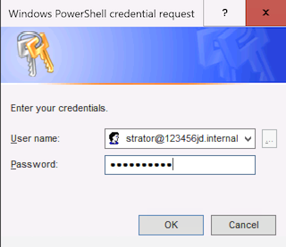

Change hostname:

```
Rename-Computer -NewName "CORE-1" -Restart
```

---

Join domain:

```
Add-Computer -DomainName "123456jd.internal" -Credential (Get-Credential) -Restart
```

 

Verify domain membership after restarting:

```
Get-CimInstance Win32_ComputerSystem |
    Select-Object Name, Domain, PartOfDomain
```

---

Open firewall for ping

```
New-NetFirewallRule -DisplayName "Allow ICMPv4 Ping" `
    -Direction Inbound -Protocol ICMPv4 -IcmpType 8 `
    -Action Allow -Profile Any

New-NetFirewallRule -DisplayName "Allow ICMPv6 Ping" `
    -Direction Inbound -Protocol ICMPv6 -IcmpType 128 `
    -Action Allow -Profile Any
```

---

Disable SConfig from launching automatically and start directly in PowerShell

```
Set-SConfig -AutoLaunch $false
Set-ItemProperty -Path "HKLM:\SOFTWARE\Microsoft\Windows NT\CurrentVersion\Winlogon" `
    -Name Shell -Value "PowerShell.exe"
```

---

Check Windows Version and OS Architecture

```
Get-CimInstance Win32_OperatingSystem |
    Select-Object Caption, Version, BuildNumber, OSArchitecture
```

---